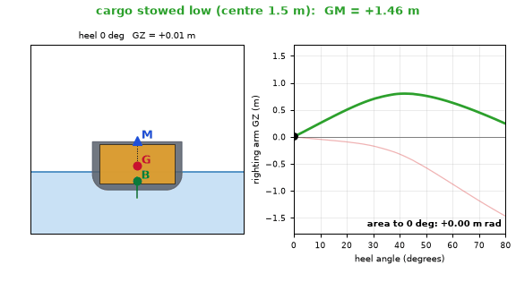
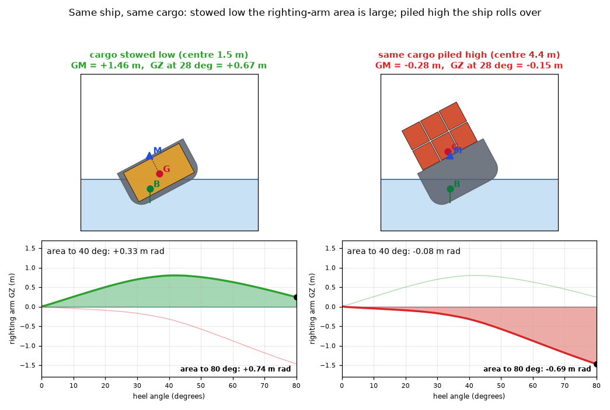
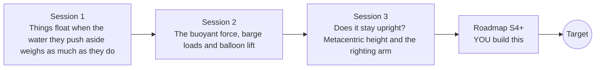

# openbuoyancy

[](https://github.com/KrunalPanchal1995/openbuoyancy/actions/workflows/ci.yml)   [](https://colab.research.google.com/github/KrunalPanchal1995/openbuoyancy/blob/main/sessions/session-01/lesson.ipynb) [](https://krunalpanchal1995.github.io/openbuoyancy/)

**Will it float, and will it stay upright? Archimedes in three sessions.**

openbuoyancy teaches why ships float and why some of them roll over, from Archimedes' principle to the metacentric height, using only Python and a browser.

- **Start from zero.** Session 1 needs only school arithmetic: density is mass divided by volume.
- **See it float.** Every session ships a slider app that runs in the browser, with labelled graphs and a heeling ship section.
- **Know you got it right.** Each session ends with a checkpoint that prints PASS or FAIL against hand calculations and an analytic limit.
- **Build the missing half.** The repo stops at the floating box on purpose; the roadmap shows the path to the Target ship.

[Target](#the-target) · [Who is this for](#who-is-this-for) · [Quick start](#quick-start) · [Sessions](#sessions) · [Roadmap](#roadmap) · [Contribute](#contribute) · [Explainer PDF](docs/explainer.pdf)

> **This repo is incomplete on purpose.** Sessions 1 to 3 are here and fully working. The finished Target below is a preview of what the community can build next. We show you the path, not the code. Sessions 4 and up are yours.

## The Target

A ship cross-section heels back and forth while its three key points move: the centre of gravity G, the centre of buoyancy B and the metacentre M. Beside it, the righting-arm curve is drawn and its area shaded. Two loadings are compared: with the cargo stowed low the area is large and the ship always comes back; with the same cargo piled high the area collapses and the ship rolls over. Your goal over the coming sessions: build this tool yourself, for a hull that is not a plain box.



*Target: a ship section heels with G, B and M marked while the righting-arm curve and its area are drawn, cargo low versus cargo high*



*Target still: the same cargo stowed low (large safe area) and piled high (the ship rolls over)*

Try it live:

- [Math Visual Studio: fluid kinematics (Atlas S58), the nearest fluids chapter](https://krunalpanchal1995.github.io/studio/#atlas?ch=S58&ex=1)

How the Target was made is shown only as a path in [promo/roadmap.md](promo/roadmap.md).

## Who is this for
**higher secondary to diploma / undergraduate (levels 4-5).** Topic area: Heat, Thermodynamics and Fluid Mechanics.

Prerequisites:

- Density as mass divided by volume, and the weight of a mass (W = m g).
- Python 3.10 or newer; if `python --version` works, you are ready. PRIMER.md explains the rest.
- Sine and tangent of an angle help in Session 3. No prior GitHub or fluid mechanics experience is needed.

New to Python? Read [PRIMER.md](PRIMER.md) first (10 minutes).

## Quick start

No installation knowledge needed. You need [Git](https://git-scm.com/downloads) and [Python 3.10+](https://www.python.org/downloads/) (Windows: tick "Add Python to PATH"). On Mac and Linux type `python3` wherever this page says `python`.

```bash
git clone https://github.com/KrunalPanchal1995/openbuoyancy.git
cd openbuoyancy
python start.py 1
```

`start.py` creates a private environment, installs what is needed and runs Session 1 with its checkpoint. Next: `python start.py 2`, `python start.py 3`, or `python start.py test` to check everything. Only a checkpoint: `python start.py check 1`.

Three lines turn the idea of Session 2 into a result (they work as they are): Save it as `try.py` and run it with `python start.py run try.py` (this uses the private environment, where NumPy is installed):

```python
import numpy as np
mass, L, B, rho = 160000.0, 20.0, 6.0, 1000.0     # barge + cargo (kg), length, beam (m), fresh water (kg/m^3)
draft = mass / (rho * L * B)                       # Archimedes: displaced water weighs as much as the barge
print(round(draft, 3), 'm deep in the water')      # -> 1.333 m
```

Every session also opens in your browser with sliders (no install): [live apps](https://krunalpanchal1995.github.io/openbuoyancy/). Or use the Colab badge above for the notebook.

## Sessions

| # | Session | Model level | Time | Live app |
|---|---|---|---|---|
| 1 | [Things float when the water they push aside weighs as much as they do](sessions/session-01/README.md) | Level 1: conceptual interactive model | 60 min | [open](https://krunalpanchal1995.github.io/openbuoyancy/session-01/) |
| 2 | [The buoyant force, barge loads and balloon lift](sessions/session-02/README.md) | Level 2: mathematical engineering model | 75 min | [open](https://krunalpanchal1995.github.io/openbuoyancy/session-02/) |
| 3 | [Does it stay upright? Metacentric height and the righting arm](sessions/session-03/README.md) | Level 3: simulation and validation | 90 min | [open](https://krunalpanchal1995.github.io/openbuoyancy/session-03/) |

Each session follows the same six steps: A real-world problem, B concept and theory, C visual explanation, D interactive simulation, E worked example and experiment, F assessment and design challenge. Each ends with `checkpoint.py`, which prints `PASS` or `FAIL` against reference numbers. Session 3 also contains the real-world mini-project: **How high can the deck cargo go?**.

## Architecture



| Folder or file | What is inside |
|---|---|
| `sessions/` | three sessions: README (A-F), `lesson.py`, notebook, live app, exercises, activity sheet, checkpoint |
| `promo/` | the Target: media, live links, and the roadmap (path only) |
| `docs/` | `explainer.tex` and the built `explainer.pdf` |
| `tests/` | runs every lesson and checkpoint headless |
| `start.py` | one command to set up and run anything |
| `QUALITY.md`, `RUBRIC.md` | the quality checklist and the scoring rubric |
| `.github/` | CI, PDF build, Pages deploy, issue and PR templates |

## Roadmap

| Milestone | What you will build | Difficulty |
|---|---|---|
| Session 4: Free surface effect | A barge model with a partly filled tank that reduces GM by its free-surface correction. | intermediate |
| Session 5: A round-bilge hull | A generalised wet-section function for any polygon hull, with the GZ curve plotted. | intermediate |
| Session 6: Roll in time | A time-stepping model of rolling that uses the GZ curve as the restoring moment. | advanced |
| Session 7: Settle at the angle of loll | A dynamic simulation of the failure case with a small disturbance. | advanced |
| Session 8: A stability report for a loading plan | A script that reads cargo items, finds KG, GM, the GZ curve and the area under it, and prints pass or fail. | advanced |

Full detail with a checkpoint per milestone: [promo/roadmap.md](promo/roadmap.md).

## Contribute
New to GitHub? Read [CONTRIBUTING.md](CONTRIBUTING.md); it starts from zero. Pick an issue labelled `good first issue`. Translations into Hindi, Telugu, Tamil and Malayalam are welcome.

<details>
<summary>Development</summary>

```bash
python start.py test        # runs every lesson and checkpoint
```
Lessons use `# %%` cell markers so they open as notebooks in VS Code. See [QUALITY.md](QUALITY.md) for the standard every session meets.
</details>

## License
MIT. See [LICENSE](LICENSE). Media in `promo/media` is (c) Krunal Panchal, CC BY 4.0.

## Acknowledgments
Part of the [PAN IIT OSS](https://hellofoss.tech-iitb.org/projects) open-source teaching collection, modelled on the structure of [openspline](https://github.com/openspline/openspline). Built on ideas from the Math Visual Studio at https://krunalpanchal1995.github.io/studio/.
