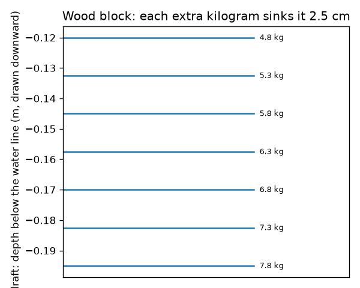
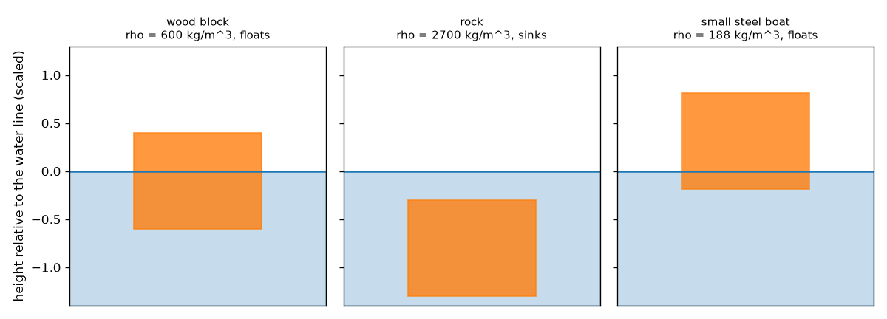
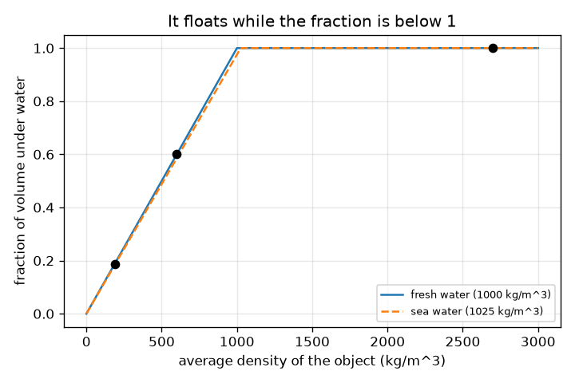

# Session 1: Things float when the water they push aside weighs as much as they do

*Level 1 (conceptual interactive model) · about 60 minutes · openbuoyancy*

> This is a simplified educational model. It is not a validated design tool and must not be used for real structures, electrical installations, vehicles, industrial processes or medical decisions.

**Prerequisites**

- Density as mass divided by volume.
- You have read PRIMER.md and run `python start.py 1` once.

**Learning objectives.** After this session you can:

- Explain why a boat, a rock and a block of wood behave differently in water.
- Use average density to decide whether something floats and how much of it is under water.
- Compute the draft of a flat-bottomed box and read a draft marking.
- Read a graph of submerged fraction against average density.

## A. Real-world problem
A steel ship weighs thousands of tonnes and floats. A pebble weighs a few grams and sinks. A wooden block floats low in a pond and a little higher in the sea. Why? Can you predict, before you try, whether something floats and how deep it will sit? (This is general science education, not a guide for boat safety.)

## B. Concept and theory
When an object is lowered into water it pushes some water out of its way. The water pushes back with a force equal to the weight of the water that was pushed aside (Archimedes' principle). An object floats when it can push aside its own weight in water before it is fully under. Because water displaced = fluid density times submerged volume, an object floats when its average density (total mass divided by total outside volume, including any air inside) is below the fluid's density, and then a fraction rho_object / rho_fluid of its volume is below the surface. For a flat-bottomed box with bottom area A, the depth under water (the draft) is mass / (rho_fluid * A). A hollow steel boat floats because its average density includes the air inside.

| Symbol | Meaning | Unit |
|---|---|---|
| rho_obj | average density of the object (mass / outside volume) | kg/m^3 |
| rho_fluid | density of the fluid (fresh water 1000, sea water about 1025) | kg/m^3 |
| f | fraction of the object's volume under water | no unit |
| m | mass of the object | kg |
| A | area of the flat bottom | m^2 |
| draft | depth of the bottom below the water line | m |

**Assumptions**

- The object is in still water in a tank so big that its level does not change.
- The object sits upright (stability is Session 3).
- Water density is constant with depth.

$$ \rho_{obj}=\frac{m}{V} $$

$$ f=\min\!\left(1,\ \frac{\rho_{obj}}{\rho_{fluid}}\right) $$

$$ \text{draft}=\frac{m}{\rho_{fluid}\,A} $$

## C. Visual explanation
The first figure shows three things in water: the wooden block (average density 600 kg/m^3) floats with 60 percent under water, the rock (2700 kg/m^3) sinks, and the steel boat (average density 187.5 kg/m^3) floats with only about 19 percent under water. The second plots the submerged fraction against average density: it rises along a straight line and stops at 1 where the density equals the water's. The third shows draft marks: each extra kilogram sinks the block 2.5 cm.

*Draft marks of a wooden block: each extra kilogram adds 2.5 cm of draft.*

*A wooden block floats, a rock sinks, and a steel boat floats high.*

*Fraction under water against average density for fresh and sea water.*

## D. Interactive simulation
Run the lesson (`python start.py 1`), then open the live app: [Session 1: float or sink](https://krunalpanchal1995.github.io/openbuoyancy/session-01/) (or `app.html` in this folder). Slide the object density and the fluid density, watch the block rise and sink and the two arrows change, then open the graph view and follow the dot along the line.

**Challenge.** Make the block float with exactly 75 percent of it under water.

## E. Worked example and experiment
**Problem.** A wooden cube of side 0.2 m has mass 4.8 kg. Does it float in fresh water? How deep does it sit? What happens in sea water (1025 kg/m^3)?

1. Volume = 0.2 * 0.2 * 0.2 = 0.008 m^3, so average density = 4.8 / 0.008 = 600 kg/m^3.
2. 600 is below 1000, so it floats. Fraction under water = 600 / 1000 = 0.60.
3. Bottom area = 0.2 * 0.2 = 0.04 m^2, so draft = 4.8 / (1000 * 0.04) = 0.120 m (60 percent of 0.2 m, as it must be).
4. In sea water: draft = 4.8 / (1025 * 0.04) = 0.117 m. It sits about 3 mm higher.

**Answer.** It floats with 60 percent under water, draft 0.120 m in fresh water and 0.117 m in sea water.

**Experiment.** Float a wooden or plastic block in a bucket, mark the water line with a pencil, measure the draft with a ruler and compare with mass / (1000 * area). Then add salt to the water and see the line move up a little. Differences come from the wood absorbing water, the block not being a perfect cube and your reading of the water line; the model assumes a perfect dry block and a flat surface.

## F. Assessment and design challenge
**Question type A: Conceptual.** Steel has a density of about 7850 kg/m^3, yet a steel ship floats. Explain, and say what would happen to the same steel hammered into a solid lump.

Hint

Think of the average density of the whole ship including the air inside.

Step-by-step solution

The ship is a hollow shell, so its total mass divided by its total outside volume (steel plus the air inside) is far below 1000 kg/m^3. In Python, a 150 kg steel boat of outside volume 0.8 m^3 has an average density of 187.5 kg/m^3 and floats, while the same 150 kg of steel as a lump has volume 0.019 m^3 and density 7850 kg/m^3 and sinks.

**Question type B: Numerical.** A block of mass 2.0 kg has a volume of 0.0030 m^3. Find its average density, whether it floats in fresh water, the fraction under water and the mass of water it pushes aside.

Hint

Average density = mass / volume; compare with 1000.

Step-by-step solution

Density = 2.0 / 0.0030 = 666.7 kg/m^3, below 1000, so it floats. Fraction under water = 666.7 / 1000 = 0.667. It pushes aside 2.0 kg of water, the same as its own mass (check: 1000 * 0.0030 * 0.667 = 2.0 kg).

**Question type C: Graph and simulation interpretation.** In the graph of submerged fraction against density, the line stops rising at density 1000 (fresh water). What does an object of density 1010 kg/m^3 do in fresh water and in sea water?

Hint

Find 1010 on the horizontal axis for each water and see whether the fraction reaches 1.

Step-by-step solution

In fresh water the fraction would be 1010 / 1000 = 1.01, which is more than 1, so it sinks. In sea water (1025) the fraction is 1010 / 1025 = 0.985, so it floats with 98.5 percent under water, just barely. Sea water gives a line that reaches 1 further to the right.

**Question type D: Design and optimisation challenge.** Design: a flat-bottomed boat has an empty mass of 150 kg and a bottom of 2.0 m by 0.8 m. In calm fresh water it must keep a draft of no more than 0.25 m. What is the largest cargo? State your assumptions.

Hint

Largest total mass = rho * A * draft_max.

Step-by-step solution

Bottom area = 1.6 m^2. Largest total mass = 1000 * 1.6 * 0.25 = 400 kg, so the cargo is at most 400 - 150 = 250 kg. Assumptions: calm water, the boat stays upright, the cargo is spread evenly and the sides are tall enough. A real boat needs a bigger safety margin (waves, uneven loading), and Session 3 shows that stability can fail even when the boat floats.

Score yourself with [RUBRIC.md](../../RUBRIC.md). Print the [activity sheet](activity_sheet.md) to work on paper.

## Common misconceptions
| Common misconception | What is actually true |
|---|---|
| Heavy things sink and light things float. | Density decides, not weight: a huge ship floats, a small pebble sinks. |
| An object floats because the water is pushing it up with a force that depends on its weight. | The upward force equals the weight of the displaced water, which depends on the submerged volume; a floating object sinks until that equals its own weight. |
| A floating object has less than its weight pushing it up. | While floating, buoyant force equals weight exactly; that is why it sits still. |
| Sea water and fresh water give the same draft. | Sea water is about 2.5 percent denser, so the same object sits slightly higher. |

## Glossary
- **density**: mass divided by volume, in kg/m^3
- **buoyant force**: the upward push of a fluid on an object in it
- **displaced water**: the water pushed out of the way by the part of the object that is under the surface
- **draft**: the depth of the lowest point of a floating object below the water line
- **average density**: total mass divided by total outside volume, counting any air inside

## Finish
1. Do the three coding tasks in [exercises.md](exercises.md).
2. Run `python start.py 1` again after your changes. It ends with the checkpoint; when it prints `PASS`, you are done. (Checkpoint only: `python start.py check 1`.)

Next: [Session 2](../session-02/README.md)
