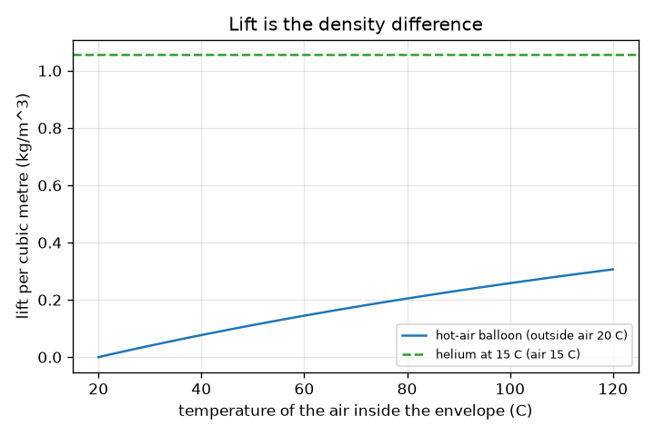
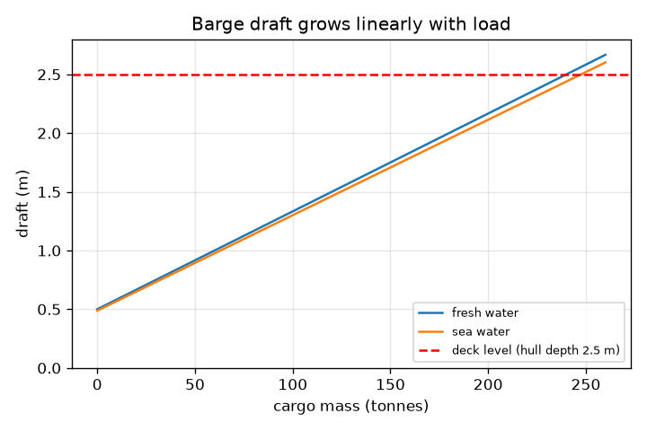
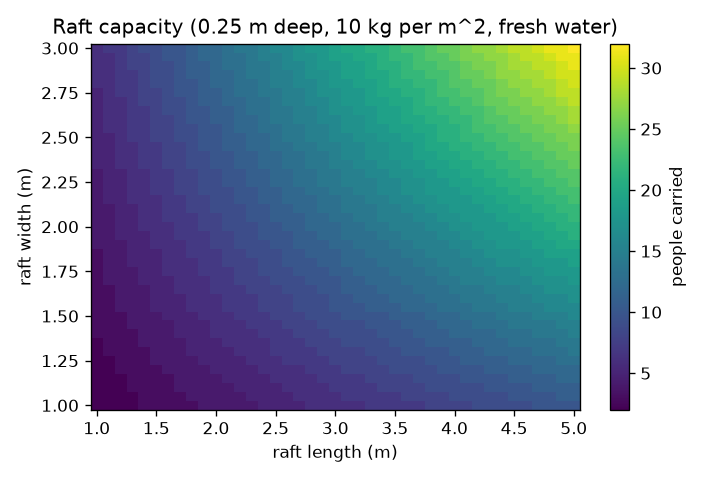

# Session 2: The buoyant force, barge loads and balloon lift

*Level 2 (mathematical engineering model) · about 75 minutes · openbuoyancy*

> This is a simplified educational model. It is not a validated design tool and must not be used for real structures, electrical installations, vehicles, industrial processes or medical decisions.

**Prerequisites**

- Session 1: average density and draft.
- Weight W = m g with g = 9.81 m/s^2.

**Learning objectives.** After this session you can:

- Use F_b = rho_fluid g V_displaced to find the buoyant force.
- Compute the draft and freeboard of a rectangular barge and its load capacity.
- Find the lift per cubic metre of a hot-air or helium balloon as a density difference.
- Solve a design problem: how big must a raft be to carry a given number of people?

## A. Real-world problem
A river barge is 20 m long and 6 m wide. How much cargo can it carry before its deck goes under water? Does the answer change when it sails out to sea? And how can a balloon rise in air with the same law? (Educational model: real vessels need larger margins, rules and professional design.)

## B. Concept and theory
The buoyant force on a body equals the weight of the fluid it displaces: F_b = rho_fluid g V_displaced. A body floats in equilibrium when this equals its weight m g. For a rectangular barge of length L, beam B and hull depth H, the displaced volume is L B d, so the draft is d = m / (rho L B) and the freeboard (deck height above the water) is H - d. The deck reaches the water at d = H, so the greatest total mass is rho L B H, and the load capacity is that minus the empty (lightship) mass; designers keep a minimum freeboard f_min, which lowers it to rho L B (H - f_min) - m_lightship. Air is also a fluid: a balloon filled with a gas of density rho_gas in air of density rho_air experiences a net lift of (rho_air - rho_gas) g V, so the lift per cubic metre is the density difference. The density of an ideal gas is rho = P M / (R T).

| Symbol | Meaning | Unit |
|---|---|---|
| F_b | buoyant force | N |
| rho | density of the fluid | kg/m^3 |
| g | gravity, 9.81 | m/s^2 |
| V | displaced volume | m^3 |
| L, B, H | barge length, beam (width), hull depth | m |
| d | draft | m |
| m | total mass of barge and cargo | kg |
| P, M, R, T | gas pressure (Pa), molar mass (kg/mol), gas constant 8.314 J/(mol K), temperature (K) | as stated |

**Assumptions**

- Still water, the barge sits level and upright (Session 3 tests the upright part).
- Sides are vertical and the bottom is flat (a box).
- Fresh water is 1000 kg/m^3 and sea water about 1025 kg/m^3; air and gases are ideal gases at 101325 Pa.
- No safety rules, waves or wind are included: this is not a design tool.

$$ F_b=\rho_{fluid}\,g\,V_{displaced} $$

$$ d=\frac{m}{\rho\,L\,B}\qquad \text{freeboard}=H-d $$

$$ m_{cargo,max}=\rho\,L\,B\,(H-f_{min})-m_{lightship} $$

$$ \text{lift per m}^3=\rho_{air}-\rho_{gas}\ \ (\mathrm{kg/m^3}),\qquad \rho=\frac{P\,M}{R\,T} $$

## C. Visual explanation
The first figure shows the barge draft growing along a straight line as cargo is added until it reaches the red deck line: at 240 t of cargo in fresh water the deck is awash, in sea water at 247.5 t. The second compares balloons: helium lifts about 1.06 kg per cubic metre in 15 C air; hot air at 100 C in 20 C air lifts only about 0.26 kg per cubic metre, so a hot-air balloon must be about four times bigger for the same payload. The third is a map of how many people a raft carries against its length and width.

*Lift per cubic metre of a hot-air balloon against the inside temperature, with helium for comparison.*

*Barge draft against cargo mass in fresh and sea water, with the deck level.*

*Number of 65 kg people a 0.25 m deep raft carries against its length and width.*

## D. Interactive simulation
Run the lesson (`python start.py 2`), then open the live app: [Session 2: a loaded barge](https://krunalpanchal1995.github.io/openbuoyancy/session-02/) (or `app.html` in this folder). Add cargo and watch the draft and freeboard change, switch to sea-water density and compare, then open the draft graph and find where the line meets the red deck line.

**Challenge.** Carry at least 200 t of cargo while keeping a freeboard of at least 0.3 m.

## E. Worked example and experiment
**Problem.** A barge 20 m long, 6 m wide with hull depth 2.5 m and empty mass 60 t carries 100 t in fresh water. Find the draft and freeboard, the greatest cargo with the deck just awash, and the greatest cargo if 0.3 m of freeboard must remain.

1. Total mass = 60 000 + 100 000 = 160 000 kg. Draft = 160 000 / (1000 * 20 * 6) = 1.333 m.
2. Freeboard = 2.5 - 1.333 = 1.167 m.
3. Deck awash: greatest total mass = 1000 * 20 * 6 * 2.5 = 300 000 kg, so cargo = 300 000 - 60 000 = 240 000 kg = 240 t.
4. With 0.3 m freeboard: 1000 * 20 * 6 * (2.5 - 0.3) = 264 000 kg total, so cargo = 204 t.
5. Check with the buoyant force: at 1.333 m draft the displaced volume is 160 m^3 and F_b = 1000 * 9.81 * 160 = 1.57 MN, equal to the weight 160 000 * 9.81 N.

**Answer.** Draft 1.333 m, freeboard 1.167 m, capacity 240 t with the deck awash and 204 t with 0.3 m freeboard.

**Experiment.** Make a rectangular boat from a plastic food box, measure its mass and bottom area, predict the draft, and load it with coins or washers while marking the draft on the side. Compare the line of draft against load with the straight line of the model. Differences come from the sloping sides, a slightly tilted box and the water level rising in the container; the model has vertical sides and a huge water body.

## F. Assessment and design challenge
**Question type A: Conceptual.** The barge sails from a river into the sea. Does its draft increase or decrease, and by what fraction? Why is this still true if the barge is empty?

Hint

Displaced water must weigh the same; compare the densities.

Step-by-step solution

The barge must displace the same mass of water, and sea water is denser, so the volume displaced is smaller and the draft decreases. The ratio is 1000 / 1025 = 0.976, so the draft drops by about 2.4 percent. It holds for any load, including the empty barge, because the rule is draft = m / (rho L B).

**Question type B: Numerical.** The same barge (20 x 6 x 2.5 m, empty 60 t) carries 100 t of cargo in sea water. Find the draft.

Hint

draft = m / (rho L B) with rho = 1025.

Step-by-step solution

Draft = 160 000 / (1025 * 20 * 6) = 160 000 / 123 000 = 1.301 m, a little less than 1.333 m in fresh water. Check units: kg / (kg/m^3 * m * m) = m.

**Question type C: Graph and simulation interpretation.** In the draft graph, the sea-water line meets the red deck line at a larger cargo than the fresh-water line. Read both values and say what the difference means.

Hint

The deck line is at 2.5 m draft; solve m = rho L B H.

Step-by-step solution

Fresh water: 240 t; sea water: 1025 * 20 * 6 * 2.5 / 1000 - 60 = 247.5 t. The difference is 7.5 t, which is the extra 2.5 percent of displaced mass that denser water can support at the same volume.

**Question type D: Design and optimisation challenge.** Design: a raft is 3.0 m long, 0.25 m deep and has a mass of 10 kg per square metre of deck. It must carry 15 people of 65 kg in fresh water and keep a freeboard of at least 0.10 m. What is the narrowest width, in steps of 0.1 m? Why might you choose a wider one?

Hint

Capacity = rho * L * B * (H - f_min) - raft mass, where raft mass = 10 * L * B.

Step-by-step solution

Capacity = 1000 * 3 * b * 0.15 - 30 * b = 420 b kg. For 15 people we need 975 kg, so b >= 975 / 420 = 2.32 m, and the narrowest width in steps of 0.1 m is 2.4 m (capacity 1008 kg, 15 people; at 2.3 m the capacity of 966 kg carries only 14). A wider raft gives a reserve for waves, uneven standing and heavier people, and it is also more stable (Session 3). The trade-off is more material, cost and weight to handle.

Score yourself with [RUBRIC.md](../../RUBRIC.md). Print the [activity sheet](activity_sheet.md) to work on paper.

## Common misconceptions
| Common misconception | What is actually true |
|---|---|
| The buoyant force depends on how deep an object is pushed once it is fully under water. | For a fully submerged object it depends on the volume only (rho g V), not on depth. |
| A bigger barge always floats lower. | Draft depends on mass divided by the water-plane area; a wider barge with the same mass floats higher. |
| Balloons rise because gas is 'lighter than nothing'. | They rise because the air they displace weighs more than the balloon and its gas: the same buoyant force as in water. |
| Zero freeboard is fine as long as it floats. | With the deck awash any small wave floods the barge; designers keep a margin, and the load capacity quoted at freeboard zero is a limit, not a target. |

## Glossary
- **buoyant force**: F_b = rho g V_displaced, the weight of the displaced fluid
- **freeboard**: height of the deck above the water line
- **lightship mass**: the mass of the empty vessel
- **load capacity**: the cargo mass at which the freeboard falls to the allowed minimum
- **ideal gas**: a gas whose density follows rho = P M / (R T)

## Finish
1. Do the three coding tasks in [exercises.md](exercises.md).
2. Run `python start.py 2` again after your changes. It ends with the checkpoint; when it prints `PASS`, you are done. (Checkpoint only: `python start.py check 2`.)

Next: [Session 3](../session-03/README.md)
