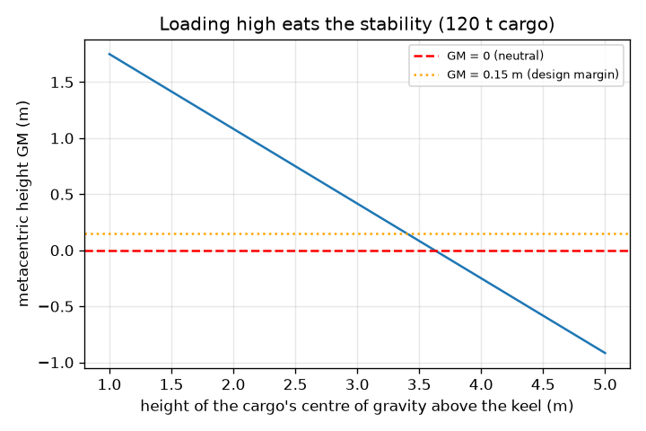
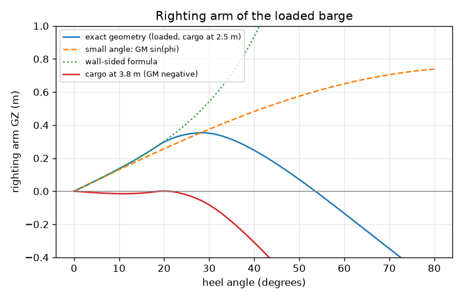
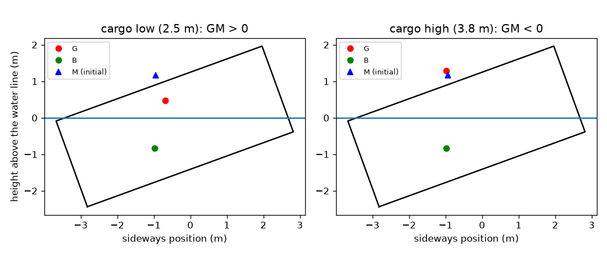

# Session 3: Does it stay upright? Metacentric height and the righting arm

*Level 3 (simulation and validation) · about 90 minutes · openbuoyancy*

> This is a simplified educational model. It is not a validated design tool and must not be used for real structures, electrical installations, vehicles, industrial processes or medical decisions.

**Prerequisites**

- Session 2: draft and the buoyant force.
- Sine, tangent and the centroid of a shape.

**Learning objectives.** After this session you can:

- Locate the centre of buoyancy B, the centre of gravity G and the metacentre M of a floating box and compute GM = KB + BM - KG.
- Compute the righting arm GZ against heel angle from exact submerged-area geometry.
- Validate the numerical result against the small-angle limit GM sin(phi) and the wall-sided formula.
- Explain and show how loading height and a cargo shift change stability, and what a negative GM does.

## A. Real-world problem
A barge with plenty of freeboard can still roll over when its cargo is piled too high. Floating is about weight and buoyancy balancing; staying upright is about what happens when something nudges the barge over. How can we test it, and how high may we stack the cargo? (Educational 2D model only: not a naval architecture tool; real ships must be assessed by qualified designers using the applicable rules.)

## B. Concept and theory
The weight of the barge acts downward at the centre of gravity G. The buoyant force acts upward at the centre of buoyancy B, which is the centre of the displaced water. Upright, both are on the centreline. When the barge heels by an angle phi the submerged shape changes, B moves toward the low side, and the two forces are a horizontal distance GZ apart: a righting arm of length GZ, giving a righting moment W * GZ. The metacentre M is the point where the buoyant force line crosses the centreline for small heel; if M is above G (GM > 0) the moment rights the barge, if below (GM < 0) it heels it further. Measuring heights up from the keel K, for a box KB = d / 2 and BM = I / V where I = L B^3 / 12 is the second moment of the water-plane area and V = L B d is the displaced volume, so BM = B^2 / (12 d). Then GM = KB + BM - KG. For a loaded barge KG is the mass-weighted mean of the heights of the empty barge and the cargo, so stacking cargo high raises KG and lowers GM. For larger angles we compute GZ exactly: rotate the rectangle, find the horizontal water line that leaves the same submerged area, and take the centroid of the wet polygon. For a box with the deck edge dry and the bilge wet the exact result is the wall-sided formula GZ = sin(phi) (GM + 0.5 BM tan^2(phi)).

| Symbol | Meaning | Unit |
|---|---|---|
| K, B, G, M | keel, centre of buoyancy, centre of gravity, metacentre (heights above the keel are KB, KG, KM) | m |
| d | draft | m |
| I | second moment of the water-plane area, L B^3 / 12 | m^4 |
| V | displaced volume | m^3 |
| BM | metacentric radius I / V | m |
| GM | metacentric height KB + BM - KG | m |
| phi | heel angle | degrees or radians |
| GZ | righting arm | m |

**Assumptions**

- Two-dimensional cross-section of a box-shaped barge with vertical sides and a flat bottom; the weight is carried by the same area at every heel angle (length times area = displaced volume).
- The barge is watertight (no flooding) and carries no free-surface liquid.
- Still water, no wind or waves; the heel is slow (static).
- Water is fresh (1000 kg/m^3); the cargo is rigid and fixed in the hull.
- A margin of GM >= 0.15 m is used here as a simple design margin; real criteria are more demanding and ship-specific.

$$ KB=\frac{d}{2},\qquad BM=\frac{I}{V}=\frac{L B^3/12}{L B d}=\frac{B^2}{12\,d} $$

$$ GM=KB+BM-KG,\qquad KG=\frac{m_0\,KG_0+m_c\,h}{m_0+m_c} $$

$$ GZ=y_G-y_B,\qquad GZ\approx GM\sin\varphi\ \text{(small angle)} $$

$$ GZ=\sin\varphi\left(GM+\tfrac12 BM\tan^2\varphi\right)\ \text{(box, deck edge dry, bilge wet)} $$

## C. Visual explanation
The first figure shows the GZ curve of the loaded barge (120 t at 2.5 m): the exact curve follows GM sin(phi) at small angles and separates from it as the heel grows; it follows the wall-sided formula until the deck edge goes under water at 18.4 degrees. The second curve is the failure case with the cargo at 3.8 m: GM is negative, so GZ is negative at small angles and the barge settles at an angle of loll near 19 degrees. The second figure draws the heeled sections with G, B and M. The third plots GM against cargo height: it falls straight with height and crosses zero near 3.6 m.

*Metacentric height against the height of the cargo's centre of gravity.*

*Righting arm GZ against heel angle: exact geometry, small-angle line, wall-sided formula and the failure case.*

*Heeled sections at 20 degrees with G, B and M: cargo low (stable) and cargo high (unstable).*

## D. Interactive simulation
Run the lesson (`python start.py 3`), then open the live app: [Session 3: will the barge stay upright?](https://krunalpanchal1995.github.io/openbuoyancy/session-03/) (or `app.html` in this folder). Drag the heel slider and watch B move while G stays in the hull, then raise the cargo and watch GM fall; in the graph view compare the exact curve with the grey small-angle curve.

**Challenge.** Carry at least 120 t while keeping the metacentric height at or above 0.5 m.

## E. Worked example and experiment
**Problem.** The barge (20 x 6 x 2.5 m, empty 60 t with its centre of gravity 1.0 m above the keel) carries 120 t of cargo whose centre of gravity is 2.5 m above the keel, in fresh water. Find GM, and the righting arm at 10 degrees exactly and by the small-angle formula.

1. Total mass 180 000 kg, so draft d = 180 000 / (1000 * 20 * 6) = 1.500 m.
2. KB = d / 2 = 0.750 m. BM = B^2 / (12 d) = 36 / 18 = 2.000 m. KM = 2.750 m.
3. KG = (60 * 1.0 + 120 * 2.5) / 180 = 360 / 180 = 2.000 m.
4. GM = 2.750 - 2.000 = 0.750 m, positive, so the barge rights itself.
5. Small angle at 10 degrees: GM sin(10 deg) = 0.750 * 0.1736 = 0.1302 m.
6. Wall-sided formula: sin(10 deg) (0.750 + 0.5 * 2.000 * tan^2(10 deg)) = 0.1736 * (0.750 + 0.0311) = 0.1356 m, which equals the exact numerical value 0.1356 m; the small-angle value is 4 percent low.

**Answer.** GM = 0.750 m (stable). At 10 degrees the exact righting arm is 0.1356 m and the small-angle estimate is 0.1302 m.

**Experiment.** Float a long rectangular plastic box (or a block of wood) in a basin, add a coin stack or weights at the bottom, then at the top, and tilt it by hand: the box with the weight low springs back, the one with the weight high sits tilted or flips. You can estimate the heeling angle after moving a weight sideways with a protractor and compare with tan(angle) = (weight * shift) / (total weight * GM). Differences come from the box not being exactly rectangular, water sloshing and the model ignoring dynamics.

## Real-world application and mini-project: How high can the deck cargo go?
A barge 20 m long and 6 m wide (hull depth 2.5 m, empty mass 60 t, empty centre of gravity 1.0 m above the keel) will carry 120 t of cargo in fresh water. Two rules must hold: the metacentric height must be at least 0.15 m, and if the cargo slips 0.2 m sideways the barge must heel by no more than 10 degrees. Use `gm_loaded` and `heel_after_shift` from Session 3 and find the highest cargo centre of gravity (in steps of 0.05 m) that meets each rule and both together.

**Deliverable:** A script that prints, for cargo heights from 1.00 m to 4.95 m in steps of 0.05 m, the GM and the heel after the 0.2 m shift, names the highest height for each rule and for both, and saves a plot of GM and heel against height with the limits drawn.

**Success looks like:** The GM rule alone allows up to 3.40 m, the heel rule is stricter, and the answer for both together is 2.50 m (GM 0.75 m, heel 9.7 degrees there; at 2.55 m the heel exceeds 10 degrees).

## F. Assessment and design challenge
**Question type A: Conceptual.** A barge has 1.2 m of freeboard but capsizes when loaded with tall stacked cargo. Explain why freeboard does not guarantee stability, and what quantity does.

Hint

Compare the height of G with that of M.

Step-by-step solution

Freeboard says how far the deck is above the water; it comes from weight and buoyancy balancing (Session 2). Stability depends on where G is relative to M. Tall cargo raises G (KG) and lowers GM = KM - KG; if G rises above M, GM is negative and a small heel is pushed further by the water instead of being corrected, regardless of how much freeboard there is.

**Question type B: Numerical.** The same barge carries 120 t with its centre of gravity at 3.0 m. Find KG and GM, and say whether it is stable.

Hint

KG = (60 * 1.0 + 120 * 3.0) / 180; KM is still 2.750 m.

Step-by-step solution

KG = (60 + 360) / 180 = 2.333 m. GM = 2.750 - 2.333 = 0.417 m. It is stable but with less than the 0.750 m of the worked example, and it is above the 0.15 m margin. Units: all heights in metres.

**Question type C: Graph and simulation interpretation.** From the GZ figure, at 20 degrees the exact curve is above the small-angle line. Read approximately both values for the loaded barge, state which is larger and give a likely reason for the difference.

Hint

The deck edge goes under at 18.4 degrees; compare 0.298 and 0.257.

Step-by-step solution

At 20 degrees the exact GZ is 0.298 m and GM sin(phi) is 0.257 m: the exact curve is about 14 percent higher. The small-angle formula assumes the centre of buoyancy moves as if the waterplane stayed a rectangle; the BM tan^2(phi) term of the wall-sided formula adds the extra shift of B as the submerged shape becomes a wedge. By 20 degrees the deck edge is just under water, so even the wall-sided formula (0.302 m) starts to overestimate.

**Question type D: Design and optimisation challenge.** Design: with 160 t of cargo (instead of 120 t), find the highest cargo centre of gravity, in steps of 0.1 m, that keeps GM at or above 0.15 m. Compare it with the 3.40 m for 120 t and explain.

Hint

Total 220 t gives draft 220 000 / 120 000 = 1.833 m; find KM and then KG_max.

Step-by-step solution

Draft = 1.833 m, KB = 0.917 m, BM = 36 / (12 * 1.833) = 1.636 m, KM = 2.553 m. KG_max = 2.553 - 0.15 = 2.403 m, so 60 + 160 h <= 2.403 * 220 = 528.7 and h <= 2.93 m; in steps of 0.1 m the answer is 2.9 m (GM = 0.171 m; at 3.0 m GM is 0.099 m, which fails). More cargo gives a lower height because it raises KG more and, since the draft rises, BM falls. Trade-off: carrying more means stowing it lower, e.g. in the hold, or accepting a smaller margin, which is not wise.

Score yourself with [RUBRIC.md](../../RUBRIC.md). Print the [activity sheet](activity_sheet.md) to work on paper.

## Common misconceptions
| Common misconception | What is actually true |
|---|---|
| If the barge floats, it is stable. | Floating needs buoyancy equal to weight; stability needs G below M. A floating vessel with GM < 0 heels over. |
| G moves when the barge heels. | G is fixed in the hull for a rigid cargo; it is B that moves, because the shape of the submerged part changes. |
| The small-angle formula GM sin(phi) is good for any angle. | It is accurate only for a few degrees; the exact curve departs from it as the deck edge goes under water or the bilge lifts. |
| A negative GM means the barge capsizes at once. | A box with a negative GM first heels to an angle of loll where GZ returns to zero (about 19 degrees in the example) and may capsize if disturbed or loaded further. |

## Glossary
- **centre of buoyancy (B)**: the centre of the displaced water, where the buoyant force acts
- **centre of gravity (G)**: the point where the whole weight acts
- **metacentre (M)**: the point where the buoyant force line crosses the centreline for a small heel
- **metacentric height (GM)**: the distance from G up to M; positive means self-righting
- **righting arm (GZ)**: horizontal distance between G and the line of the buoyant force
- **angle of loll**: the heel angle at which a vessel with negative GM comes to rest
- **heel**: tilting sideways

## Finish
1. Do the three coding tasks in [exercises.md](exercises.md).
2. Run `python start.py 3` again after your changes. It ends with the checkpoint; when it prints `PASS`, you are done. (Checkpoint only: `python start.py check 3`.)

Next: the [roadmap](../../promo/roadmap.md). Session 4 is yours to build.
